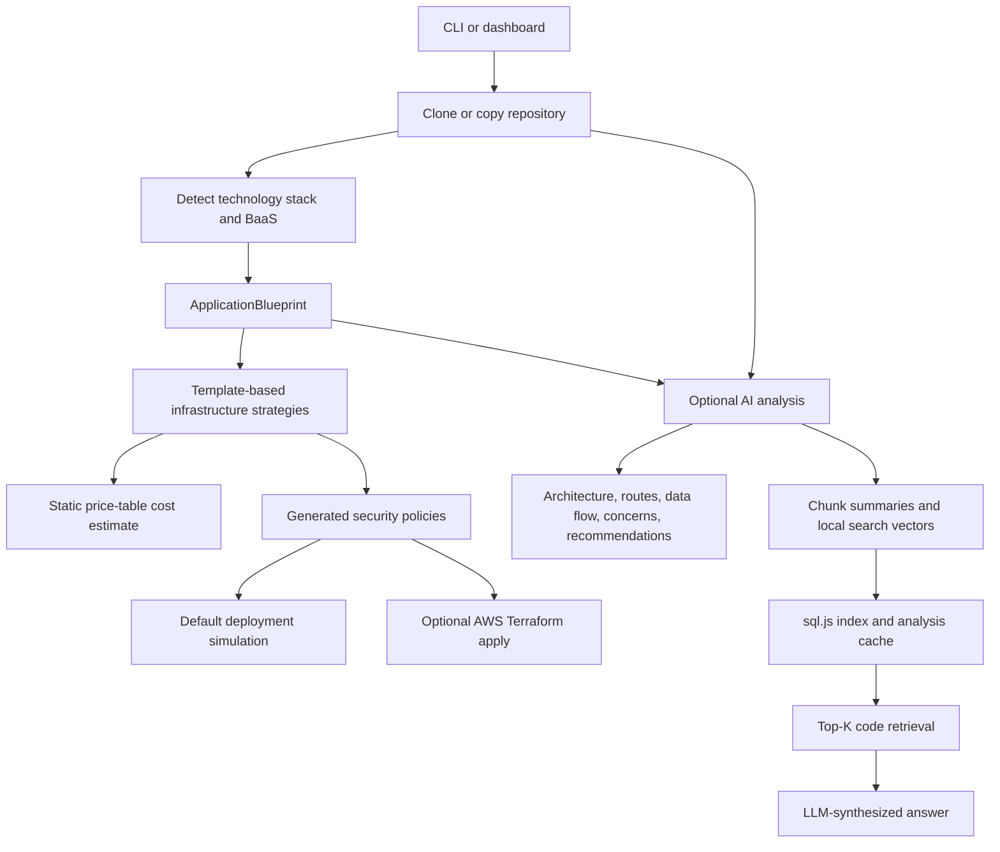

# LaunchPilot architecture and LLM layer

This review starts from upstream commit `b371e8e` and describes the resulting
Catalyst integration. The main application is a TypeScript npm workspace.

## Entry points and flow

| Area | Implementation | Responsibility |
| --- | --- | --- |
| CLI | `packages/cli/bin`, `packages/cli/src/commands` | Analyze, estimate, deploy, index, search; interactive cloud/tier/migration selection |
| Shared engine | `packages/core/src` | Agents, types, detectors, cloud templates, AI clients, storage and Terraform |
| Web | `packages/web/src/app`, `components`, `hooks` | Next.js dashboard and deployment wizard; server API; SSE progress |
| Legacy tree | `src`, root `bin` | Retained duplicate code used by older tests/imports; root executable delegates to the workspace CLI |
| Fixtures/tests | `tests` | Detector, agent, Terraform, provider, CLI and pipeline verification |

## Deterministic deployment engine

`IngestionAgent` uses `simple-git` for shallow clones or copies a `local://`
directory into a temporary workspace. It detects Node, Python, Java, Go and Ruby
projects, Docker and Compose, frameworks, databases, external services, environment
variable names, ports, build/start commands and complexity. BaaS detection adds
Supabase/Firebase and related platform dependencies and migration context.

`InfraPlannerAgent` maps this blueprint to AWS, GCP or Azure resource templates
and creates low, medium and high scaling tiers. BaaS choices determine whether
to self-host capabilities, keep a vendor or migrate to another vendor.
`CostEstimatorAgent`/`calculateCost` use local pricing tables and usage assumptions;
they do not query current provider pricing. `SecurityAgent` combines scanner
findings and generated IAM, network, secrets, TLS and WAF policies.

`DeployAgent` simulates checkpoints and URLs unless `live` is explicitly set.
The live implementation checks Terraform/AWS credentials, writes HCL, runs
Terraform and translates its events/outputs back into deployment progress.
The implementation is AWS-specific; the presence of GCP/Azure plans and simulated
providers does not establish a live deployment implementation for those clouds.

The web app persists deployments in `better-sqlite3`, launches jobs from the
server API, and broadcasts progress via an in-process SSE event store. Its job
execution is fire-and-forget within the server process, not a durable worker queue.

## LLM boundary

`LLMProvider` supplies connection validation, plain-text analysis, JSON analysis,
chunk summarization, rough token estimates and cumulative usage. The factory now
supports `CatalystClient`, `ClaudeClient` and `OllamaClient`. A shared configuration
resolver gives CLI commands, server routes and programmatic callers consistent
provider and model selection. Existing Anthropic model overrides now take effect.

`AIAnalyzerAgent` selects source files by priority: entry points, routes, config,
models, security code and services. Defaults cap selection at 20 files and truncate
individual files at 8,000 characters. Its total budget is checked using a rough
four-characters-per-token estimate. Analysis is therefore a bounded review of
selected source, not an exhaustive repository audit.

The agent asks for application purpose, architecture, API routes, data flow,
security concerns and deployment recommendations. The schema was previously
declared but omitted from the actual prompt. It is now supplied to the model,
and output is checked with Zod before use. Source text is explicitly treated as
untrusted input in the system prompt.

The selected files are divided into semantic code chunks. Each chunk receives a
summary from the configured chat model. A deterministic SHA-256-based projection
of summary words produces a 256-value vector. This is word-overlap retrieval,
not a pretrained semantic embedding; the hash projection also repeats dimensions.
`SemanticSearch` projects the query locally, ranks stored chunks by cosine
similarity and asks the analysis model to synthesize an answer from the top K.

`VectorStore` uses sql.js/WASM SQLite for chunks, summaries, vectors, repository
metadata and cached analysis. Cache identity now includes selected source and
prompt contents, provider, endpoint, analysis/summary models and reasoning
settings. An index fingerprint ensures the currently stored chunks correspond
to that cache entry. Changing providers/models or selected source reindexes;
`index` explicitly forces regeneration. Secrets are excluded from the fingerprint.

The current AI output is advisory: it is shown in the CLI/dashboard and indexed
for search. Infrastructure planning still consumes the deterministic blueprint;
AI-generated recommendations do not directly rewrite Terraform or trigger tools.

## Integration boundaries and remaining product work

- Catalyst traffic follows the same chat-completion/header contract as Athar.
  The explicit Compass mode uses the same environment names and credential-file
  pattern. No gateway deployment, cluster route or Athar configuration was changed.
- AI review in the dashboard is now opt-in. The server supplies provider settings,
  retains the clone until review finishes, and cleans it up on success/failure.
  The page presents model name, architecture, purpose, concerns and recommendations.
- The live Terraform task definition still contains `nginx:alpine`; repository
  build, image publication and application rollout remain separate unfinished
  product work. No live infrastructure deployment was needed for this integration.
- The web APIs have no application authentication/tenant boundary in this source,
  and the shared local index/event store is not a multi-user service design.
  The index rewrites a local sql.js file; concurrent writers need coordination
  before treating it as a durable shared backend.
- The root `src` tree duplicates much of the workspace core. The touched AI code
  was kept in sync and both provider implementations are tested. Consolidating
  the remaining legacy tree is separate maintenance work.
- Root/CLI TypeScript resolution now matches the workspace's existing bundler
  import style. Conflicting sql.js declarations were consolidated so the workspace
  builds can validate the new provider end to end. The web build externalizes
  sql.js so its WASM file is resolved correctly when AI indexing runs in production.

See [Catalyst configuration and model verification](CATALYST.md) for the concrete
request contract, environment variables and observed Compass model access.
