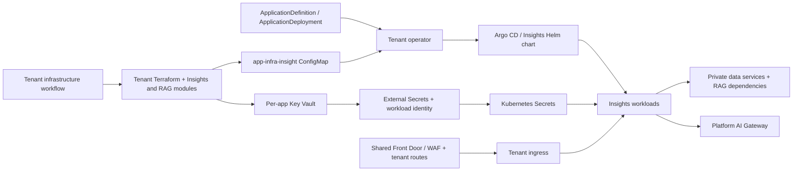

# Insights deployment contracts in Cortex

Inspected 2026-10-01. Repository: [Cortex-Inception/cortex](https://github.com/Cortex-Inception/cortex), pinned to [`e0276084411453671652819e5012ae1b07812135`](https://github.com/Cortex-Inception/cortex/tree/e0276084411453671652819e5012ae1b07812135), the initial fetched `main` revision (the connected refresh below uses a newer pin). Inspection used committed files, not the local checkout's uncommitted changes. These findings describe repository declarations; no cloud resources, Terraform state, cluster or deployment were inspected or changed.

## Connected refresh and deployment view

The saved Cortex connection now tracks `https://github.com/Cortex-Inception/cortex` / `main`. A live fetch on 2026-10-01 resolved [`12efdb0a4d7d8551ce2c34152ed4891eb2c7fa03`](https://github.com/Cortex-Inception/cortex/tree/12efdb0a4d7d8551ce2c34152ed4891eb2c7fa03). Its production registry still selects `insight-0-0-2` with `rag-ingestion-0-1-0`; the development release is not used for production. The earlier source audit below retains its original commit links.

New planning on Cortex fetches the saved branch, resolves environment-registered definitions and their dependency closure, renders the selected chart/value layers, and saves a separate commit-pinned architecture before requesting AI recommendations. Refresh failures do not fall back to stale artifacts or change an existing selected plan. Application code evidence is reused from its saved snapshot; it is not rescanned by this workflow. Git objects and settings stay in private runtime storage, and the user's Cortex checkout is untouched. Authentication uses the server's existing Git or GitHub CLI access. Helm must be on PATH or configured through `LAUNCHPILOT_HELM_BIN`.

The connected production render has 23 steady-state pods across 12 workloads, plus two batch Jobs and seven init-container definitions. Jobs are excluded from the steady-state total, HPA ranges are shown separately, and DaemonSet counts require eligible node counts. Omitted Deployment/StatefulSet replicas use the documented Kubernetes default of one and are labelled accordingly. These counts describe the selected render, not a live cluster.

The connector also traces Terraform `configmap` outputs through the operator’s `appInfra` projection into rendered workloads, identity annotations and secret stores. Direct resource references and unambiguous resource-name expressions produce evidence-backed connections; unknown producers remain unresolved. Helm’s implicit release namespace is applied to known namespaced preview kinds so internal Services are not mistaken for external dependencies.

The deployment view groups Services with a single selected workload, shows six horizontal layers, and places supporting resources and source references in the component inspector. Every original resource and connection remains available; grouping does not change pod totals. The main page keeps recommendations, coverage and advanced connection settings collapsed. Components and connections remain editable.

AI review recovery now has a visible **Retry AI review** action, including missing/stale-job states. It resumes saved checkpoints; there is no manual completion checkbox. Native Cortex script export now uses the saved deployment contract independently of the optional AI review. It includes the full local Terraform module closure (including disabled modules needed by init), selected charts, dependency definitions, tenant output-delivery workflow, controller/CRD references and parameterized ApplicationDeployment manifests. Replica edits compile into proven Helm value paths and are checked by re-rendering against the displayed workload counts. Other runtime changes require a native implementation and receive a specific blocker. Terraform state boundaries are preserved. Bicep is not an equivalent deployment path for this selected Terraform contract. No generated bundle has been certified deployable.

Validation: 137 architecture/unit/integration checks passed across the suite and subsequent targeted checks, TypeScript checks passed, and the web production build passed. The connector was exercised against the actual Cortex branch and rendered Insights production using Helm. The generated native bundle passed Terraform initialization and validation for tenant, base and frontdoor-edge roots, plus Helm lint/render and bundle/contract checks. Cloud/state planning, cluster admission, deployment and runtime health remain explicitly unverified. The latest optional AI review retry was unable to reach Catalyst; native script generation is available independently. No Terraform apply, Azure deployment or Kubernetes apply was performed.

## The deployment model is different from the saved plan

The saved LaunchPilot Insights snapshot `b12bc42edcb309385397768ae7d18ec1f1cd7c7553d22da6df3d2095090ed094` is from `Cortex-Inception/insight-saas` at `1724902e3b971592a013d5d75ebe282b6c08ddc3`. Its selected `deploy/cortex/prod` uses legacy `ApplicationDefinition.spec.components`, an array of capability providers, and `CortexApp` instances.

Current Cortex uses `ApplicationDefinition`/`ApplicationDeployment`, the tenant operator, Argo CD Helm applications and per-tenant Terraform. The GVK of `ApplicationDefinition` is reused, but its schema differs: `spec.applicationId`, `deployment`, `infrastructure` and an object-valued `capabilities` containing roles/policy. The current Insights definition declares infrastructure mode `Terraform` and outputs targeting `appInfra.*` Helm values. Searches of current `infra`, `platform`, `gitops` and `docs/adr` found no legacy `cortex-postgresql`, `cortex-redis`, `CapabilityDefinition` or `CortexApp` implementation.

Evidence: [Insights definition](https://github.com/Cortex-Inception/cortex/blob/e0276084411453671652819e5012ae1b07812135/gitops/_application-definitions/insight-0-0-2/definition.yaml), [3.0.1 definition overlay](https://github.com/Cortex-Inception/cortex/blob/e0276084411453671652819e5012ae1b07812135/gitops/_application-definitions/insight-3-0-1/kustomization.yaml), [accepted deployment-model ADR](https://github.com/Cortex-Inception/cortex/blob/e0276084411453671652819e5012ae1b07812135/docs/adr/ADR-26-06-24-insight-deployment-on-cortex-2.md).

Do not copy newer provider settings into legacy capability `config`/`params` fields. Their compatibility has not been established. Selecting Cortex 2 requires a new plan grounded in both the application source and the platform deployment files; it is not a mutation of the existing plan's deployment owner.

## Selected current target

The user selected current Cortex on 2026-10-01. The separate saved target is Azure / prod / `insight-0-0-2` at the pinned Cortex commit above. The production registry selects this definition and replaces its dependencies with `rag-ingestion-0-1-0`; the existence of a 3.0.1 definition elsewhere does not select it for production. [Production registry and patches](https://github.com/Cortex-Inception/cortex/blob/e0276084411453671652819e5012ae1b07812135/gitops/prod/application-definitions/kustomization.yaml).

Combined snapshot: `3f523e44d4ee2d91fb8c2c809b59c1bae9ac08620806d1eb6eabb93277c425ae`. Design: `f3f15de7411d00b96c1961d5e2d6f7d9b84811a74693c8f09c7e241b5086c1a4`. Application source observations retain their original repository/commit provenance. Legacy deployment resources and their previous plan are not carried into this target. The original saved review remains available with `original=1`.

Local Helm rendering used chart defaults, the selected service and platform production values, and explicit unresolved operator inputs. It found 12 continuously running workload templates with 23 pod replicas, two migration Jobs, and seven init-container definitions. The namespace, tenant identity and infrastructure endpoints remain preview inputs. The rendered manifests are evidence for chart structure and counts, **not deployment artifacts**. No live cluster was queried.

## Existing implementation and configuration flow

| Area | Committed implementation | Consequence for generation |
| --- | --- | --- |
| Application workloads | `services/insight/chart/templates/`, with chart defaults, `values-prod.yaml`, `gitops/prod/app-values/insight.yaml`, then operator-injected inline values | Preserve the selected environment's value precedence and actual workload templates. Do not copy local PostgreSQL or another environment's settings into production. |
| Per-app Azure resources | `infra/tenant/app/insight/`: PostgreSQL, Redis, Service Bus, Blob Storage, AI Search, Speech, Translator, Document Intelligence, App Configuration, Key Vault, identities, RBAC and private endpoints | Enhance the existing Terraform resources and module inputs. These are not missing infrastructure just because they are absent from the application repo. |
| Non-secret configuration | Module `configmap` output → tenant-infra workflow → `app-infra-insight` ConfigMap → tenant operator → `.Values.appInfra.*` | Retain exact output names, producer/consumer mappings and Helm injection. Endpoint existence alone does not establish application connectivity. |
| Credentials | Per-app Key Vault secrets → workload identity and federated service accounts → chart SecretStore/ExternalSecrets → application Kubernetes Secrets | Reuse the vault, identities, ownership and secret-key mappings. Do not generate a second vault or a competing secret controller. |
| Runtime configuration | App Configuration resources/keys exist; production chart comments explicitly leave `appConfig.enabled` at its false default | Distinguish provisioned configuration from enabled delivery. Verify each production setting's actual env/secret/config source. |
| Edge | `infra/base/frontdoor-edge.tf` defines a shared Front Door profile/endpoint/WAF; `infra/frontdoor-edge/main.tf` defines tenant origins, routes, domain/DNS and private-link integration | Check selected platform/tenant ownership before proposing another Front Door/WAF. Presence in source is not proof it is applied. |
| Network policies | Insights chart `templates/networkpolicy.yaml`, enabled by production `cortexEgress` values | Review the actual Insights production policy; an unrelated admin portal policy is not equivalent evidence. |
| RAG integration | `infra/tenant/cross-app-rag-insight.tf` and peer outputs in `apps.tf` | Preserve Insights → RAG queue send, RAG → Insights result queue send, RAG blob read and Insights search read. Exporting the Insights submodule alone omits these root-owned permissions. |
| LLM route | Production `llmGateway.config` points model aliases to the platform AI gateway | Preserve gateway routing and model identifiers from the selected environment. The current per-app module does not create Azure OpenAI. |

Primary references:

- [Per-app module contract](https://github.com/Cortex-Inception/cortex/blob/e0276084411453671652819e5012ae1b07812135/infra/tenant/app/insight/README.md), [resource set](https://github.com/Cortex-Inception/cortex/blob/e0276084411453671652819e5012ae1b07812135/infra/tenant/app/insight/main.tf), [output contract](https://github.com/Cortex-Inception/cortex/blob/e0276084411453671652819e5012ae1b07812135/infra/tenant/app/insight/outputs.tf).
- [Workflow output projection](https://github.com/Cortex-Inception/cortex/blob/e0276084411453671652819e5012ae1b07812135/.github/workflows/tenant-infra.yml#L362), [operator value merge](https://github.com/Cortex-Inception/cortex/blob/e0276084411453671652819e5012ae1b07812135/platform/services/tenant-operator/internal/controller/applicationdeployment_controller.go#L1269).
- [Secret delivery templates](https://github.com/Cortex-Inception/cortex/blob/e0276084411453671652819e5012ae1b07812135/services/insight/chart/templates/app-infra-externalsecrets.yaml), [production service values](https://github.com/Cortex-Inception/cortex/blob/e0276084411453671652819e5012ae1b07812135/services/insight/chart/values-prod.yaml), [production platform values](https://github.com/Cortex-Inception/cortex/blob/e0276084411453671652819e5012ae1b07812135/gitops/prod/app-values/insight.yaml).
- [Shared edge](https://github.com/Cortex-Inception/cortex/blob/e0276084411453671652819e5012ae1b07812135/infra/base/frontdoor-edge.tf), [tenant edge/DNS](https://github.com/Cortex-Inception/cortex/blob/e0276084411453671652819e5012ae1b07812135/infra/frontdoor-edge/main.tf), [cross-app permissions](https://github.com/Cortex-Inception/cortex/blob/e0276084411453671652819e5012ae1b07812135/infra/tenant/cross-app-rag-insight.tf).

This diagram summarizes the cited contracts. It does not certify the current live deployment or replace environment-specific Helm rendering.

## Grounded limitations and recommendations

1. **Insights PostgreSQL HA is not implemented in its module.** `postgres.tf` declares one Flexible Server and no `high_availability` block or replica server. Its defaults are PostgreSQL 16, `GP_Standard_D4ds_v5`, 128 GiB storage, 14-day backup retention and geo-redundant backup enabled. Backup support is present; HA is a separate gap. The shared `infra/modules/postgres-flexible-server` module supports HA and enforces production policy, but Insights does not call it. A migration should preserve/import the existing resource address and data, then validate the chosen region/SKU/HA policy. Do not present a generic three-node database diagram as implemented Azure HA. [Insights server](https://github.com/Cortex-Inception/cortex/blob/e0276084411453671652819e5012ae1b07812135/infra/tenant/app/insight/postgres.tf), [defaults](https://github.com/Cortex-Inception/cortex/blob/e0276084411453671652819e5012ae1b07812135/infra/tenant/app/insight/variables.tf), [shared HA implementation](https://github.com/Cortex-Inception/cortex/blob/e0276084411453671652819e5012ae1b07812135/infra/modules/postgres-flexible-server/main.tf).
2. **Existing Redis is Azure Cache for Redis.** Its module includes TLS, a private endpoint and an Entra data-plane access-policy assignment. Do not silently replace it with Managed Redis during template generation; a selected migration must preserve client authentication/URI semantics and handle data/cutover separately. [Redis module](https://github.com/Cortex-Inception/cortex/blob/e0276084411453671652819e5012ae1b07812135/infra/tenant/app/insight/redis.tf).
3. **Bicep parity is not established for Insights.** The current Insights definition selects Terraform. Cortex contains Bicep for bootstrap/control-plane infrastructure, but those files are not an equivalent implementation of this per-tenant Insights footprint. An exported Bicep alternative must cover the same resources, identities, outputs, secret delivery, cross-app permissions and rollout; compilation alone cannot establish parity.
4. **A standalone copy of the Insights module is incomplete.** The tenant root supplies network/DNS IDs, namespace, OIDC issuer, shared ACS and peer resource inputs. An enhancement export must preserve those dependencies as verified existing platform contracts. A from-scratch export must implement the selected platform foundation and controllers as well, or explicitly require a compatible existing platform; it cannot label those dependencies implemented by omitting them.

## LaunchPilot changes made during this check

- Distinguish current Cortex platform definitions from legacy CortexApp definitions, including mixed YAML streams. Preserve declared infrastructure-output → Helm-value bindings as unresolved until their provider is grounded.
- Give generic infrastructure generation the selected immutable deployment files, related reuse evidence, resources, bindings, connections and provenance, alongside the plan. Previously it received the plan alone.
- Save a distinct current Cortex target and preserve both repository pins; resolve local production definition overlays before chart rendering.
- Review large selected deployment files in bounded batches with checked part coverage. The shared design retains the resource/connection graph; findings and configuration receive separate complete review passes. Saved checkpoints are reused on retry.
- Show current Cortex in the saved review and redirect the original review link to the selected target. Keep supporting Terraform resources and external platform references collapsed while preserving their inspectable connections.
- Block current Cortex from falling through to either the generic ARM wrapper or the legacy CortexApp exporter. Neither implements native tenant state ownership and operator/Helm output projection.

The native compiler described above replaces the original export blocker. Full Terraform/Bicep execution parity is not claimed; this target uses its declared native Terraform/Helm path. The legacy bundle must not be advertised as a current Cortex deployment. The selected Helm renders still need actual tenant/operator inputs, and cloud planning, server-side validation, test deployment and runtime health checks have not run.

Initial verification (before the connected workflow changes above): 118 relevant unit/integration tests passed across the architecture and validation suites, including subsequent reruns after fixing the oversized-file regression. Core and web TypeScript checking and the production Next.js build passed. The selected source snapshot scanned 261 relevant files, with original sources and preview-rendered documents retained; this is not represented as an exhaustive scan of every file in Cortex. AI review completion and deployability are separate from these implementation checks.
